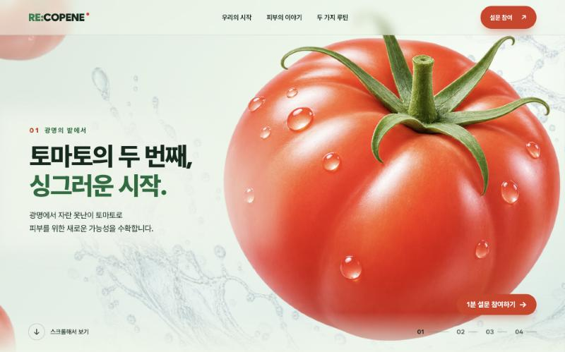
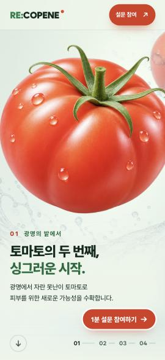
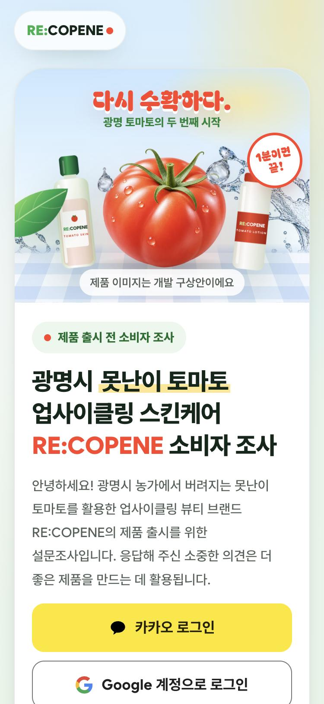
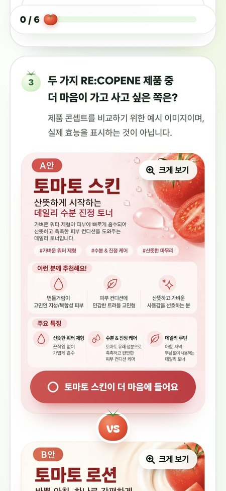
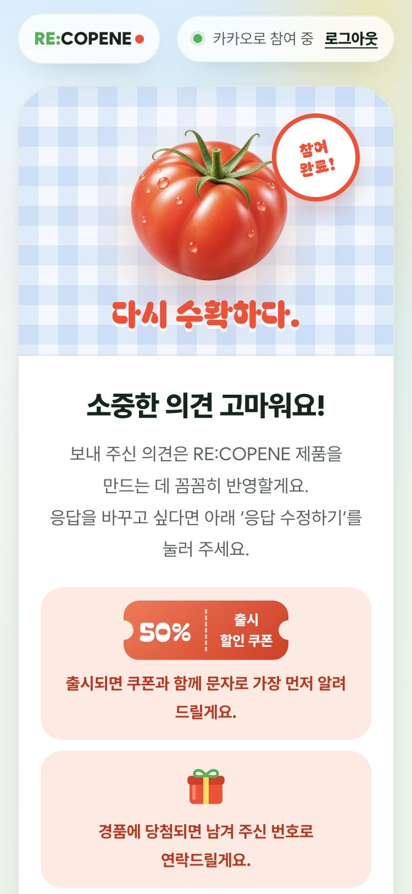

# RE:COPENE — 다시 수확하다

광명시에서 버려지는 **못난이 토마토**로 만드는 업사이클링 스킨케어 브랜드 **RE:COPENE**의 브랜드 사이트와 제품 출시 전 소비자 조사입니다.
Team HEEHEE가 광명시 청년생각 펼침 사업 2026으로 진행했습니다.

- 사이트: https://recopene.site
- 소비자 조사: https://recopene.site/survey/

<p>
  
</p>

<p>
  
  
  
  
</p>

## 무엇이 들어 있나요

### 브랜드 사이트 (`index.html`)

- 스크롤에 따라 장면이 바뀌는 첫 화면. WebGL 토마토가 물방울을 지나 스킨·로션으로 이어집니다.
- 두 가지 루틴(스킨·로션), 광명에서 시작하는 제작 과정, 리뷰에서 배운 점, 피부 고민별 제품 방향, 선물 패키지, 지역 순환과 개발 계획을 차례로 소개합니다.
- 첫 화면과 상단 고정 버튼에서 바로 설문으로 이동할 수 있습니다.

### 소비자 조사 (`survey/`)

- **카카오·구글 로그인**으로 계정당 한 번 참여합니다. 카카오는 동의 항목 없이 회원번호만 사용합니다.
- **6문항**: 연령대, 구매 기준, 제품 A/B 선호(A안 토마토 스킨·B안 토마토 로션 카드 중 선택, 카드는 크게 보기로 확대), 구매 의향, 최대 지불 금액, 구매하지 않을 이유.
- **선택 혜택**: 경품 응모(이름·휴대전화 번호)와 출시 알림·50% 할인 쿠폰(휴대전화 번호).
- **응답 수정**: 제출한 뒤 다시 들어오면 지난 응답을 불러와 고쳐 저장할 수 있습니다. 혜택 체크를 해제하고 저장하면 그 혜택에만 쓰던 이름·번호는 지워집니다.
- **개인정보 처리방침**: [`survey/privacy.html`](survey/privacy.html). 응답은 2026년 12월 31일까지 보관한 뒤 파기합니다.

## 기술 스택

| 영역 | 사용 기술 |
| --- | --- |
| 화면 | HTML, CSS, JavaScript (빌드 도구 없음) |
| 모션 | three.js 0.147 (WebGL), GSAP 3.12 + ScrollTrigger, Lenis |
| 서버 | Vercel Serverless Functions (Node.js, `api/`) |
| 데이터 | Supabase Postgres (`survey_responses` 테이블) |
| 로그인 | 카카오 로그인 REST API (자체 OAuth 흐름), Supabase Auth (구글) |
| 배포 | Vercel, 도메인 `recopene.site` |

## 폴더 구조

```
.
├── index.html           # 브랜드 사이트
├── fresh.css            # 브랜드 사이트 스타일
├── assets/              # 이미지(webp/png)와 서브셋 폰트 — 출처와 제작 방법은 assets/ASSETS.md
├── survey/
│   ├── index.html       # 설문 페이지 (로그인 · 문항 · 혜택 · 응답 수정)
│   ├── privacy.html     # 개인정보 처리방침
│   ├── config.js        # Supabase 공개 설정 (URL, anon key)
│   ├── schema.sql       # 테이블 생성 SQL, 결과 조회·정리 쿼리
│   └── SETUP.md         # Supabase · 구글 · 카카오 · Vercel 설정 가이드
├── api/                 # Vercel 서버 함수
│   ├── _lib.js          # 세션 서명, 로그인 확인, Supabase 호출 공통 코드
│   ├── me.js            # 로그인 상태와 저장된 응답
│   ├── submit.js        # 응답 검증과 저장 (계정당 1개, 수정하면 덮어씀)
│   ├── logout.js        # 카카오 세션 쿠키 삭제
│   └── kakao/           # 카카오 로그인 시작(login.js)과 콜백(callback.js)
├── docs/images/         # README 스크린샷
└── DESIGN_PLAN.md       # 초기 디자인 기획 노트
```

## 설문은 이렇게 동작해요

1. **로그인**
   - 카카오: `/api/kakao/login` → 카카오 인가 → `/api/kakao/callback`에서 회원번호를 받아 서명한 세션 쿠키(최대 7일)를 굽습니다.
   - 구글: 브라우저에서 Supabase Auth로 로그인하고, 서버 함수를 부를 때 액세스 토큰을 `Authorization` 헤더로 보냅니다.
2. **`GET /api/me`**: 누구인지 확인하고 저장된 응답이 있으면 함께 돌려줍니다. 처음이면 설문, 이미 냈으면 완료 화면과 '응답 수정하기' 버튼을 보여 줍니다.
3. **`POST /api/submit`**: 만 14세 확인과 필수 동의를 검사합니다. 경품 응모는 이름(2–30자), 혜택은 휴대전화 번호를 확인한 뒤 계정 키(`kakao:…`, `google:…`)로 Supabase에 upsert합니다.
4. **데이터 보호**: `survey_responses`는 RLS를 켜고 정책을 하나도 두지 않았습니다. 브라우저의 anon key로는 읽기·쓰기가 모두 막히고, 서버 함수만 `service_role` 키로 저장합니다.

## 로컬에서 실행

화면만 볼 때 (설문 로그인과 저장은 동작하지 않음):

```bash
python3 -m http.server 8765
```

브라우저에서 http://localhost:8765 를 엽니다.

설문까지 확인할 때는 Vercel CLI로 서버 함수를 함께 띄웁니다. 아래 환경 변수가 필요합니다.

```bash
vercel dev
```

http://localhost:3000/survey/ 에서 확인합니다.

## 환경 변수

Vercel 프로젝트의 **Settings → Environment Variables**에 넣습니다. 코드에는 넣지 않습니다.

| 이름 | 설명 |
| --- | --- |
| `SUPABASE_URL` | Supabase 프로젝트 주소 |
| `SUPABASE_SERVICE_ROLE_KEY` | Supabase `service_role` 키 (서버 함수 전용) |
| `KAKAO_REST_API_KEY` | 카카오 REST API 키 |
| `SESSION_SECRET` | 카카오 세션 쿠키 서명용 무작위 문자열 (`openssl rand -base64 32`) |
| `KAKAO_CLIENT_SECRET` | 선택. 카카오 Client Secret을 켠 경우에만 |

Supabase·구글·카카오 콘솔 설정은 [`survey/SETUP.md`](survey/SETUP.md)에 단계별로 정리돼 있습니다.

## 배포

```bash
vercel deploy --prod
```

`.vercelignore`에 적힌 기획 문서와 SQL·설정 가이드는 배포에서 빠집니다. 환경 변수를 바꾼 뒤에는 다시 배포해야 적용됩니다.

## 설문 결과 보기

Supabase **SQL Editor**에서 [`survey/schema.sql`](survey/schema.sql) 아래 주석에 있는 쿼리를 실행하면, 문항별 칸으로 나눈 결과를 볼 수 있습니다. 같은 파일에 경품 전달 뒤 이름·번호를 지우는 쿼리도 있습니다.

## 크레딧

- 기획·디자인·개발: Team HEEHEE (광명시 청년생각 펼침 사업 2026)
- 폰트: [Wanted Sans](https://github.com/wanteddev/wanted-sans), [Bagel Fat One](https://github.com/google/fonts/tree/main/ofl/bagelfatone) — 둘 다 SIL Open Font License 1.1
- 이미지: 토마토·물방울 이미지는 AI로 만든 구상안이며, 제품과 패키지 이미지는 개발 구상안입니다. 자세한 내용은 [`assets/ASSETS.md`](assets/ASSETS.md)를 참고하세요.
